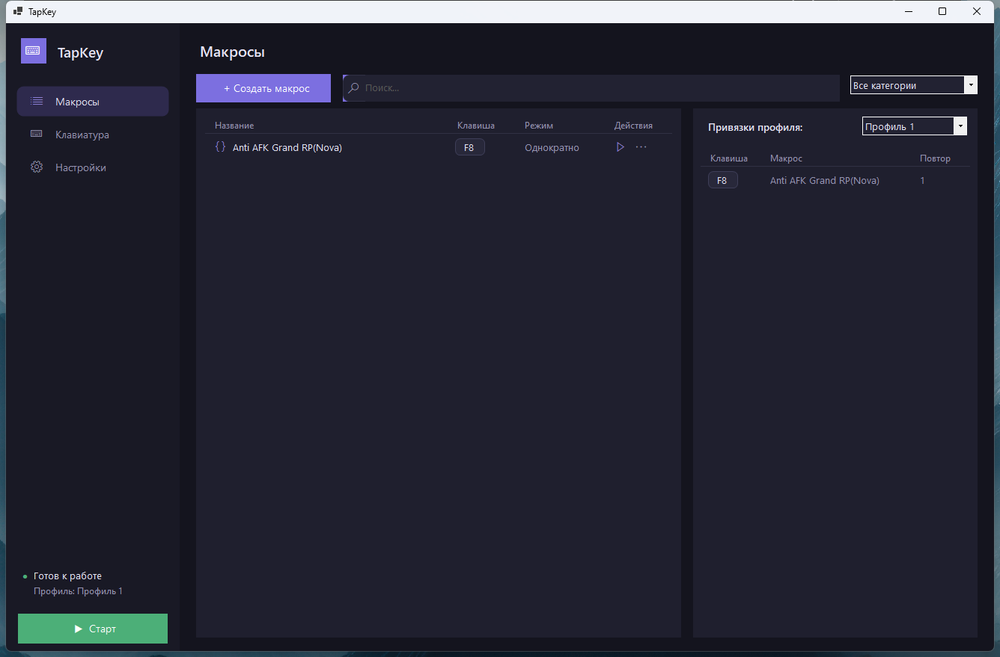
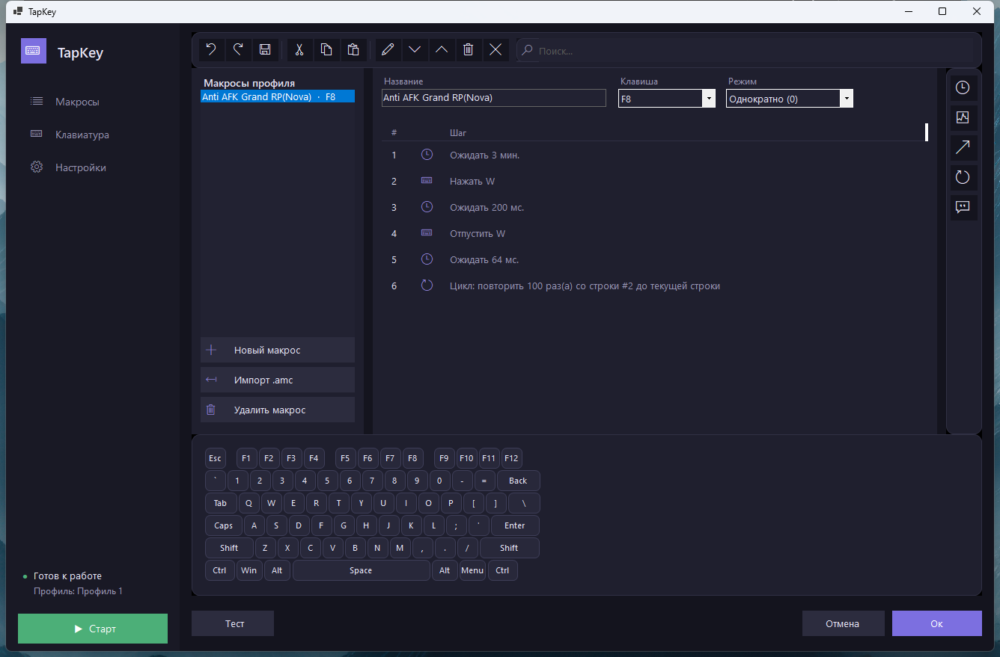

# TapKey

**Офлайн-инструмент для макросов на клавиатуру и мышь.** Совместим с форматом макросов `.amc` от Keyran, работает полностью локально — без аккаунта, подписки, онлайн-каталога и сетевых проверок.

> Неофициальный проект. Не связан с Keyran и его авторами. Формат `.amc` поддерживается только для импорта ваших собственных макросов.



## Возможности

- **Профили и привязки** — несколько профилей, привязка макроса к любой клавише.
- **Редактор макросов** в стиле Keyran: нумерованные человекочитаемые шаги («Ожидать 3 мин.», «Нажать W», «Цикл: повторить 100 раз(а)…»), отмена/возврат, вырезать/копировать/вставить, перемещение и удаление строк.
- **Режимы повтора**: однократно, удержание, переключение.
- **Экранная клавиатура** — вставка нажатий кликом; быстрое назначение действий на клавишу.
- **Импорт `.amc`** от Keyran и **импорт/экспорт** всей конфигурации одним файлом.
- **Два метода ввода**: системный (`SendInput`) и низкоуровневый через драйвер **Interception** (аппаратный уровень).
- Тёмный интерфейс, запуск поверх игр, автозапуск с Windows.



## Установка

1. Скачайте `TapKey-Setup-x.y.z.exe` со страницы [**Releases**](../../releases/latest).
2. Запустите установщик (нужны права администратора — ставится в `Program Files`).
3. Запустите TapKey из меню «Пуск».

Сборка самодостаточная (x86) — отдельно устанавливать .NET не нужно.

### Драйвер (по желанию)

Часть игр не реагирует на системный ввод. Для низкоуровневого ввода установите драйвер:
**Настройки → Драйвер → «Установить драйвер»**, затем перезагрузите компьютер. Используется открытый драйвер [Interception](https://github.com/oblitum/Interception) (лицензия zlib).

## Приватность

TapKey не отправляет никаких данных в сеть. Все профили и макросы хранятся локально в
`%AppData%\TapKey\config.tapkey`.

## Сборка из исходников

```bash
dotnet publish src/TapKey.App/TapKey.App.csproj -c Release -r win-x86 --self-contained true -o publish/x86
```
Приложение 32-битное намеренно — так работает 32-битный драйвер Interception. Установщик собирается через [Inno Setup](https://jrsoftware.org/isinfo.php): `ISCC installer/TapKey.iss`.

## Лицензии

TapKey поставляется с DLL драйвера [Interception](https://github.com/oblitum/Interception) (© Francisco Lopes, лицензия zlib) — текст уведомления прилагается к установленному приложению (`Interception-NOTICE.txt`).
